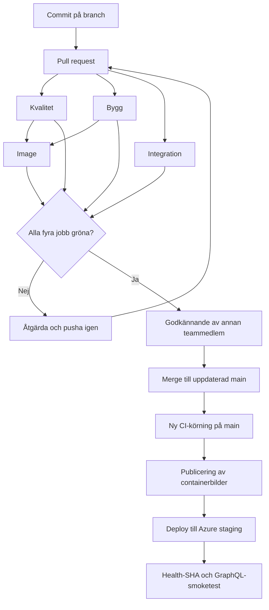

# CI/CD-pipeline

Workflowen finns i `.github/workflows/ci.yml`.
Den körs på pull requests och på push till main.

## Flöde



Image-jobbet väntar på Kvalitet och Bygg.
Integration kör parallellt och krävs separat före merge.

## Jobb

| Jobb | Vad det kör | Vad det fångar |
|---|---|---|
| Kvalitet | npm ci, lint, formatkontroll, klienttester, API-konfigurationstester och typecheck | Stilfel, testfel och typfel |
| Bygg | npm ci och npm run build | Fel i bygget av Vue-klienten |
| Integration | Databasservices, npm ci, seed, migrering och test:api | Fel i GraphQL, databasåtkomst, N+1 och inloggningskrav |
| Image | Bygger API- och klientimages | Fel i Docker-byggena |
| Deploy → Azure staging | Efter grön Image och Integration på push till `main`; OIDC-inloggning, uppdaterar API- och klientimage, väntar på rätt health-SHA och röktestar GraphQL | Fel i deploy, revisionens start, konfiguration eller databassvar |

Bygg laddar upp `client/dist` som artifact.

På pull requests bygger Image utan att publicera.
På main publiceras API- och klientimages till GHCR med
SHA-tagg och `latest`.

Deploy bygger inga images. Det använder de SHA-taggade images som Image-jobbet byggde från samma commit. Jobbet behöver både Image och Integration, kör endast efter push till `main`, och använder GitHub-miljön `azure-staging` samt OIDC (`id-token: write`). Azure-ID:n ligger som miljövariabler i GitHub; inga GitHub secrets behövs för Azure-inloggningen.

Jobbet uppdaterar först API-containern och sedan klientcontainern i Azure Container App. Varje uppdatering skapar en revision. Därefter väntar jobbet tills Azure rapporterar att senaste revision är redo och `/api/health` svarar med workflowens fullständiga commit-SHA. Till sist skickar det en GraphQL-fråga genom nginx och kräver minst en tur från databasen.

Deploy är **inte** en status check som kan godkännas före merge. På en pull request hoppas jobbet över. Det körs efter merge, på den commit som faktiskt hamnade på `main`; om Deploy misslyckas blir staging inte uppdaterad även om själva merge-committen ligger kvar på `main`.

## Kvalitet

Testerna delas upp så att Kvalitet inte behöver databaser:

```bash
npm run test --workspace=client
npm run test --workspace=api -- src/config.test.js
```

API-integrationstesterna körs i jobbet Integration.

På main omfattar rotens `npm run typecheck` shared, API och
klient. Klientsteget kör GraphQL Code Generator före vue-tsc.

Codegen läser schemat direkt ur `api/src/graphql/schema.js`.
Ingen API-server behöver vara igång för typgenereringen.

## Integration

Jobbet startar Postgres 16 och MongoDB 8.2 som services.
Healthchecks används innan jobbstegen körs.

Stegen körs i denna ordning:

```bash
npm ci
npm run seed
npm run migrate:logs
npm run test:api
```

Databaserna är tomma vid jobbets start. Seedningen fyller
Postgres och migreringen skriver turdokumenten till MongoDB.

### Miljövariabler

Följande variabler sätts på jobbnivå:

- `DATABASE_URL` – Postgres på localhost:5432.
- `MONGO_URL` – MongoDB på localhost:27017 med authSource=admin.
- `JWT_SECRET` – nyckel avsedd enbart för CI-tester.

De gäller för seed, migrering och tester.

Den lokala `.env`-filen finns inte i CI.
Meddelandet `.env not found. Continuing without it.` är därför
normalt när variablerna redan är satta i jobbet.

### Portar

| Miljö | Postgres | MongoDB |
|---|---|---|
| Lokal Node-process mot Compose | localhost:5433 | localhost:27017 |
| API-container i Compose | postgres:5432 | mongo:27017 |
| GitHub Actions-jobbet | localhost:5432 | localhost:27017 |

## Regler för merge

Det aktiva rulesetet för main kräver:

- Pull request.
- Minst ett godkännande från en annan teammedlem.
- Godkända checks från GitHub Actions:
  - Kvalitet
  - Bygg
  - Integration
  - Image
- Att branchen är uppdaterad mot main.

Rulesetet blockerar även force push och borttagning av main.
Bypass-listan är tom.

[Ruleset för main](https://github.com/Thebeatkicks/DevVuers/rules/23586241)

## Verifiering och mätningar

Alla fyra jobb passerade i följande körning på main:

[Grön körning](https://github.com/Thebeatkicks/DevVuers/actions/runs/39934692464)

I den körningen:

- Seed och migrering kördes före API-testerna.
- 6 integrationstester och 4 konfigurationstester passerade.
- Integration tog cirka 53 sekunder från jobbstart till avslut,
  inklusive containerstart och städning.

Tider varierar mellan körningar och ska kopplas till en viss körning.

### Bevis att röd Integration blockerar merge

TODO: dokumentera verifieringen med länk eller skärmbild.

- Test-PR: [länk].
- Misslyckad obligatorisk check: Integration.
- GitHubs merge-status: [observerat resultat].
- Test-PR stängd utan merge: [ja/nej].

En tillfällig test-PR finns som #83. Kontrollera resultat och
status innan den används som färdigt bevis. Den ska inte mergas.

[Temporär test-PR #83](https://github.com/Thebeatkicks/DevVuers/pull/83)

### Jämförelse av `npm ci` före och efter borttagandet av `web/`

Tiderna är stegtiderna från GitHub Actions-jobbloggarna, avrundade till hela sekunder. Före-mätningen är main-körning 41037122902, före PR #96; efter-mätningen är main-körning 41629682887, efter PR #96.

| Jobb | Före (`npm ci`) | Efter (`npm ci`) |
| --- | ---: | ---: |
| Kvalitet | 7 s | 24 s |
| Bygg | 6 s | 27 s |
| Integration | 8 s | 28 s |

- [Före: main-körning 41037122902](https://github.com/Thebeatkicks/DevVuers/actions/runs/41037122902)
- [Efter: main-körning 41629682887](https://github.com/Thebeatkicks/DevVuers/actions/runs/41629682887)

Det här är en observation från en körning på vardera sidan, inte ett stabilt prestandatest. Stegtiderna blev längre efter ändringen, vilket visar att runnerbelastning och nätverk påverkar mätningen. Vi drar därför ingen slutsats om att `npm ci` blev snabbare; mätningen dokumenterar vad de två jobbloggarna faktiskt visar.

### M6 Deploy på main

PR #97 visade Deploy som överhoppat medan de fyra vanliga kontrollerna passerade. Efter merge körde [main-workflowen 41630187005](https://github.com/Thebeatkicks/DevVuers/actions/runs/41630187005) alla fem jobb gröna. Deploy tog 1 min 23 s; hela workflowen tog 2 min 30 s.

Health svarade med HTTP 200 och samma SHA som workflowens `headSha`: `8ca7b318496bd1a28b4d3dad53c2178cc3e5c412`. GraphQL-smoketestet returnerade minst en tur. Revisionerna i Azure var:

| Revision | Status | Roll |
|---|---|---|
| `utpost-staging--k024z1j` | Healthy, Stopped | Före M6-deployen |
| `utpost-staging--sha-8ca7b31-api` | Healthy, Stopped | Mellanrevision efter API-uppdatering |
| `utpost-staging--sha-8ca7b31` | Healthy, aktiv, 1 replica | Slutrevision med API och klient |

Deploy-loggen verifierar health-SHA och GraphQL; den manuella health-kontrollen verifierade även Postgres och MongoDB som friska. Se README:s [M6-bevis](../README.md#i-molnet-m6).

## Felsökning

### JWT_SECRET måste vara satt

Kontrollera att JWT_SECRET finns under `integration.env`,
inte bara på teststeget eller inne i en databas-service.
Även seedningen importerar API-konfigurationen.

### Anslutning till Postgres misslyckas

Kontrollera healthcheck och DATABASE_URL.
I CI används localhost:5432, inte lokalutvecklingens port 5433.

### Mongo-punkter saknas

Kontrollera att `npm run migrate:logs` har körts efter seed
och före testerna. `Tour.logs` läser från MongoDB.

### Integrationstester startar i Kvalitet

Kontrollera testkommandona. Rotens `npm test` kör även
API-integrationstester och ska därför inte användas som
teststeg i Kvalitet utan tillhörande databaser.

### Grönt lokalt men rött i CI

Kontrollera skillnader i miljövariabler, databasportar,
seedning, migrering och committade filer.

Se [teststrategin](testing.md) för lokal körning och
[README](../README.md) för M5- och M6-bevisen.
