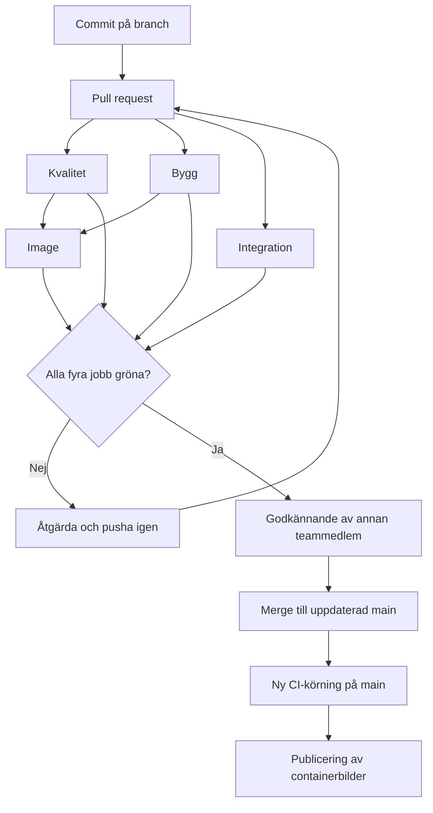

# CI/CD-pipeline

Workflowen finns i `.github/workflows/ci.yml`.
Den körs på pull requests och på push till main.

## Flöde



Image-jobbet väntar på Kvalitet och Bygg.
Integration kör parallellt och krävs separat före merge.

## Jobb

| Jobb | Vad det kör | Vad det fångar |
|---|---|---|
| Kvalitet | npm ci, lint, formatkontroll, klienttester, API-konfigurationstester och typecheck | Stilfel, testfel och typfel |
| Bygg | npm ci och npm run build | Fel i bygget av web och client |
| Integration | Databasservices, npm ci, seed, migrering och test:api | Fel i GraphQL, databasåtkomst, N+1 och inloggningskrav |
| Image | Bygger API- och klientimages | Fel i Docker-byggena |

Bygg laddar upp `client/dist` som artifact.

På pull requests bygger Image utan att publicera.
På main publiceras API- och klientimages till GHCR med
SHA-tagg och `latest`.

## Kvalitet

Testerna delas upp så att Kvalitet inte behöver databaser:

```bash
npm run test --workspace=client
npm run test --workspace=api -- src/config.test.js
```

API-integrationstesterna körs i jobbet Integration.

På main omfattar rotens `npm run typecheck` shared, API och
klient. Klientsteget kör GraphQL Code Generator före vue-tsc.

Codegen läser schemat direkt ur `api/src/graphql/schema.js`.
Ingen API-server behöver vara igång för typgenereringen.

## Integration

Jobbet startar Postgres 16 och MongoDB 8.2 som services.
Healthchecks används innan jobbstegen körs.

Stegen körs i denna ordning:

```bash
npm ci
npm run seed
npm run migrate:logs
npm run test:api
```

Databaserna är tomma vid jobbets start. Seedningen fyller
Postgres och migreringen skriver turdokumenten till MongoDB.

### Miljövariabler

Följande variabler sätts på jobbnivå:

- `DATABASE_URL` – Postgres på localhost:5432.
- `MONGO_URL` – MongoDB på localhost:27017 med authSource=admin.
- `JWT_SECRET` – nyckel avsedd enbart för CI-tester.

De gäller för seed, migrering och tester.

Den lokala `.env`-filen finns inte i CI.
Meddelandet `.env not found. Continuing without it.` är därför
normalt när variablerna redan är satta i jobbet.

### Portar

| Miljö | Postgres | MongoDB |
|---|---|---|
| Lokal Node-process mot Compose | localhost:5433 | localhost:27017 |
| API-container i Compose | postgres:5432 | mongo:27017 |
| GitHub Actions-jobbet | localhost:5432 | localhost:27017 |

## Regler för merge

Det aktiva rulesetet för main kräver:

- Pull request.
- Minst ett godkännande från en annan teammedlem.
- Godkända checks från GitHub Actions:
  - Kvalitet
  - Bygg
  - Integration
  - Image
- Att branchen är uppdaterad mot main.

Rulesetet blockerar även force push och borttagning av main.
Bypass-listan är tom.

[Ruleset för main](https://github.com/Thebeatkicks/DevVuers/rules/23586241)

## Verifiering och mätningar

Alla fyra jobb passerade i följande körning på main:

[Grön körning](https://github.com/Thebeatkicks/DevVuers/actions/runs/39934692464)

I den körningen:

- Seed och migrering kördes före API-testerna.
- 6 integrationstester och 4 konfigurationstester passerade.
- Integration tog cirka 53 sekunder från jobbstart till avslut,
  inklusive containerstart och städning.

Tider varierar mellan körningar och ska kopplas till en viss körning.

### Bevis att röd Integration blockerar merge

TODO: dokumentera verifieringen med länk eller skärmbild.

- Test-PR: [länk].
- Misslyckad obligatorisk check: Integration.
- GitHubs merge-status: [observerat resultat].
- Test-PR stängd utan merge: [ja/nej].

En tillfällig test-PR finns som #83. Kontrollera resultat och
status innan den används som färdigt bevis. Den ska inte mergas.

[Temporär test-PR #83](https://github.com/Thebeatkicks/DevVuers/pull/83)

## Felsökning

### JWT_SECRET måste vara satt

Kontrollera att JWT_SECRET finns under `integration.env`,
inte bara på teststeget eller inne i en databas-service.
Även seedningen importerar API-konfigurationen.

### Anslutning till Postgres misslyckas

Kontrollera healthcheck och DATABASE_URL.
I CI används localhost:5432, inte lokalutvecklingens port 5433.

### Mongo-punkter saknas

Kontrollera att `npm run migrate:logs` har körts efter seed
och före testerna. `Tour.logs` läser från MongoDB.

### Integrationstester startar i Kvalitet

Kontrollera testkommandona. Rotens `npm test` kör även
API-integrationstester och ska därför inte användas som
teststeg i Kvalitet utan tillhörande databaser.

### Grönt lokalt men rött i CI

Kontrollera skillnader i miljövariabler, databasportar,
seedning, migrering och committade filer.

Se [teststrategin](testing.md) för lokal körning och
[README](../README.md) för M5-bevisen.