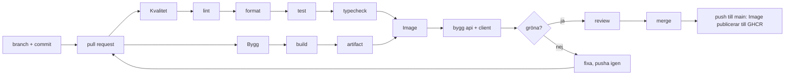

# CI/CD-pipeline

Pipelinen körs på varje pull request och på varje push till `main`. Workflowen ligger i `.github/workflows/ci.yml`.

## Flöde från commit till merge

Pipelinen har tre jobb. Kvalitet och Bygg körs parallellt, och Image startar först när båda är gröna:

- **Kvalitet** kör lint, formatkontroll, test och typkontroll, i den ordningen.
- **Bygg** bygger applikationen och laddar upp `client/dist` som artifact.
- **Image** bygger Docker-imagen för `api` och `client`. På pull requests bygger jobbet bara, för att visa att Dockerfilerna fungerar, och hoppar över inloggningen. På push till `main` loggar det också in i GHCR och publicerar imagen.

Alla jobb som installerar beroenden använder `npm ci`, som installerar exakt de versioner som står i `package-lock.json`. Inga steg i CI använder `--fix` eller `--write`, så pipelinen rättar aldrig koden själv. Den säger bara till om något är fel.

## Vad varje steg fångar

| Steg | Kommando | Fångar |
|---|---|---|
| Installation | `npm ci` | Att `package-lock.json` stämmer med `package.json` och att alla beroenden går att installera |
| Lint | `npm run lint` | Kodfel som går att hitta utan att köra koden, till exempel oanvända variabler, `v-for` utan `:key` och felstavade namn |
| Format | `npm run format:check` | Kod som inte följer Prettiers formatering, till exempel indrag, citattecken och tomma rader |
| Test | `npm test` | Kod som inte beter sig som förväntat, till exempel att en vy inte visar rätt data |
| Typkontroll | `npm run typecheck` | Typfel i `shared` och `api`, till exempel att ett svar inte stämmer med den delade typen |
| Bygge | `npm run build` | Fel som bara syns när appen byggs för produktion, till exempel felaktiga importer eller filnamn med fel stor bokstav |
| Image | `docker build` (via `build-push-action`) | Fel i `api/Dockerfile` eller `client/Dockerfile`, till exempel filer som saknas i bygget eller fel sökvägar |

Lint, format och test gäller just nu bara `client/`. Typkontrollen gäller `shared` och `api`. Bygget omfattar både `web/` och `client/`.

## Images i GHCR

Imagen publiceras bara vid push till `main`, aldrig från pull requests. På en pull request är inloggningssteget överhoppat. Jobbet `image` har `packages: write` och inga andra jobb har det.

| Image | Taggar |
|---|---|
| `ghcr.io/thebeatkicks/devvuers-api` | `sha-<kortsha>`, `latest` |
| `ghcr.io/thebeatkicks/devvuers-client` | `sha-<kortsha>`, `latest` |

Storlekar före och efter multi-stage står i README under "Mätningar M4".

## Uppmätta tider

Tiderna kommer från en och samma körning i GitHub Actions på `main` efter mergen av PR #70 (CI #74).

| Jobb | Steg | Tid |
|---|---|---:|
| Kvalitet | `npm ci` | 6 s |
| Kvalitet | `lint` | 2 s |
| Kvalitet | `format:check` | 1 s |
| Kvalitet | `test` | 4 s |
| Kvalitet | `typecheck` | 2 s |
| Kvalitet | Hela jobbet | 22 s |
| Bygg | `npm ci` | 8 s |
| Bygg | `build` | 3 s |
| Bygg | Hela jobbet | 20 s |
| Image | Bygge och publicering av api + client | 38 s |
| | Hela körningen | 1 min 5 s |

Tabellen visar de viktigaste stegen. Uppstart av varje jobb (checkout, Node och liknande) ingår i jobbtiderna men visas inte som egna rader. Kvalitet och Bygg körs parallellt och Image väntar på dem, så hela körningen är ungefär den längsta av de två plus Image, plus väntetid mellan jobben. På en pull request är Image kortare (32 s i en mätning på PR #70), eftersom inloggning och uppladdning till GHCR hoppas över.

## Ruleset på `main`

`main` är skyddad med ett ruleset som kräver:

- att alla ändringar går via en pull request
- minst en godkännare
- att status checks från workflowen (**Kvalitet**, **Bygg** och **Image**) är gröna
- att branchen är uppdaterad mot `main` innan merge
- att reglerna gäller alla, även admins

Om något steg misslyckas blockeras merge. Felet måste åtgärdas och en ny commit pushas, och då körs pipelinen igen.